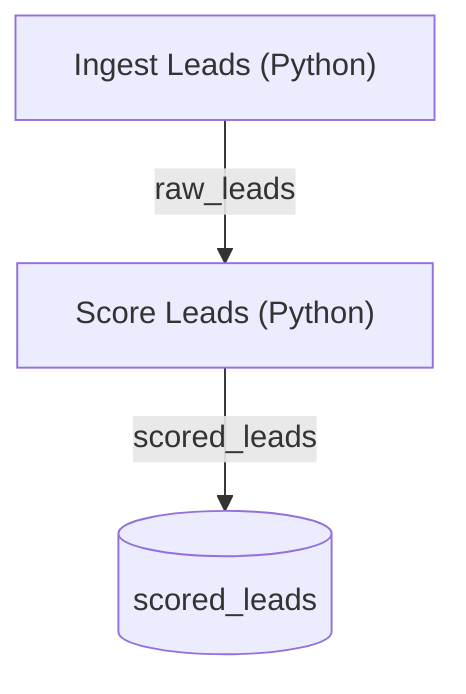

<p>&nbsp;</p>
<p align="center">
  
</p>
<p>&nbsp;</p>
<p align="center">
  <em>Patterns - Build data systems from re-usable sql and python components</em>
</p>

---

### What is the Patterns Devkit?

The Patterns Devkit is a CLI and lightweight SDK to build, version, and deploy data graphs made of reusable SQL and Python nodes. It helps you:
- Scaffold apps (graphs) and nodes quickly
- Define connections between nodes and storage tables in `graph.yml`
- Manage secrets and configuration
- Upload, list, and trigger runs in the Patterns platform

Documentation: `https://www.patterns.app/docs/devkit`

### Features
- Create graphs and nodes (`python`, `sql`, subgraphs) from the CLI
- Describe graph topology declaratively in `graph.yml`
- Write nodes using `patterns.Table`, `patterns.Parameter`, and `patterns.State`
- Manage secrets, auth, and uploads to the Patterns platform
- Trigger and inspect graphs remotely

### Installation

`pip install patterns-devkit`

### Quickstart: Build a Leads Ingestion and Scoring Graph

1) Create an app (graph)

```bash
patterns create app my-leads-app
cd my-leads-app
```

This creates:

```text
my-leads-app/
  graph.yml
```

2) Add two Python nodes

```bash
patterns create node --title "Ingest Leads" ingest_leads.py
patterns create node --title "Score Leads" score_leads.py
```

This adds:

```text
my-leads-app/
  graph.yml
  ingest_leads.py
  score_leads.py
```

3) Wire the graph in `graph.yml`

Open `graph.yml` and connect node inputs/outputs to tables:

```yaml
title: Leads Scoring

stores:
  - table: raw_leads
  - table: scored_leads

functions:
  - node_file: ingest_leads.py
    title: Ingest Leads
    trigger: manual
    outputs:
      leads: raw_leads

  - node_file: score_leads.py
    title: Score Leads
    inputs:
      leads: raw_leads
    outputs:
      scored: scored_leads
```

4) Implement the nodes

`ingest_leads.py` (writes raw leads):

```python
from patterns import Table, Parameter

def run():
    # Optionally parameterize where to ingest from
    source = Parameter("leads_source", description="Lead source label", type=str, default="marketing_form")

    raw_leads = Table("raw_leads", mode="w", description="Raw inbound leads")
    # Provide schema and helpful ordering for downstream streaming if desired
    raw_leads.init(
        schema={"id": "Text", "email": "Text", "source": "Text", "created_at": "Datetime"},
        unique_on="id",
        add_created="created_at",
    )

    # Replace this with real ingestion (API/CSV/etc.)
    sample = [
        {"id": "L-001", "email": "user1@example.com", "source": source},
        {"id": "L-002", "email": "user2@corp.com",   "source": source},
        {"id": "L-003", "email": "ceo@enterprise.com","source": source},
    ]
    raw_leads.upsert(sample)
```

`score_leads.py` (reads raw leads, writes scored leads):

```python
from patterns import Table

def lead_score(email: str) -> float:
    # Simple heuristic: enterprise domains score higher
    domain = email.split("@")[-1].lower()
    if domain.endswith("enterprise.com"):
        return 0.95
    if domain.endswith("corp.com"):
        return 0.8
    return 0.4

def run():
    raw = Table("raw_leads")               # read mode by default
    scored = Table("scored_leads", "w")    # write mode
    scored.init(
        schema={"id": "Text", "email": "Text", "score": "Float", "created_at": "Datetime"},
        unique_on="id",
        add_created="created_at",
    )

    rows = raw.read()  # list[dict] or dataframe if configured
    for r in rows:
        r["score"] = lead_score(r["email"])
    scored.upsert(rows)
```

5) Visualize the example graph topology



6) Authenticate and upload

- Sign up or sign in at `https://studio.patterns.app`
- Authenticate the CLI:

```bash
patterns login
```

- Upload your graph:

```bash
patterns upload
```

7) Trigger runs

```bash
# Trigger any node by title or id (see list commands below to find ids)
patterns trigger node "Ingest Leads"
patterns trigger node "Score Leads"
```

### Command overview

- `patterns create app <dir>`: scaffold a new app directory with `graph.yml`
- `patterns create node <file.py|file.sql|graph.yml>`: add a function node (Python/SQL/subgraph)
- `patterns create node --type table <table_name>`: add a table store
- `patterns create secret <name> <value>`: create an organization secret
- `patterns upload`: upload current app to the platform
- `patterns list apps|nodes|webhooks|versions`: list resources
- `patterns trigger node <title|id>`: manually trigger a node
- `patterns download <app>`: download app contents from the platform
- `patterns update`: update local metadata from remote
- `patterns delete <resource>`: delete remote resources
- `patterns config --json`: print CLI configuration
- `patterns login` / `patterns logout`: authenticate the CLI

See full help:

```
patterns --help
```

### Node development APIs (Python)
Nodes use a small SDK provided by the platform when running:
- `Table(name, mode="r"|"w")`: read/write table abstraction. Common methods:
  - `init(schema=..., unique_on=..., add_created=..., add_monotonic_id=...)`
  - `read(as_format="records"|"dataframe", chunksize=...)`
  - `read_sql(sql, ...)`
  - `append(records)`, `upsert(records)`, `replace(records)`, `truncate()`, `flush()`
- `Parameter(name, description=None, type=str|int|float|bool|datetime|date|list, default=MISSING)`: declare runtime parameters
- `State`: simple key-value state for long-running or iterative jobs

For more, visit the docs: `https://docs.patterns.app/docs/node-development/python/`

### Tips
- Prefer explicit schemas on write tables via `Table.init` to control types and indexes
- Use `unique_on` and `upsert` to deduplicate reliably
- Add `add_created` or `add_monotonic_id` to enable robust downstream streaming
- Keep node code small, composable, and parameterized for reuse

### License

BSD-3-Clause (see `LICENSE`)
